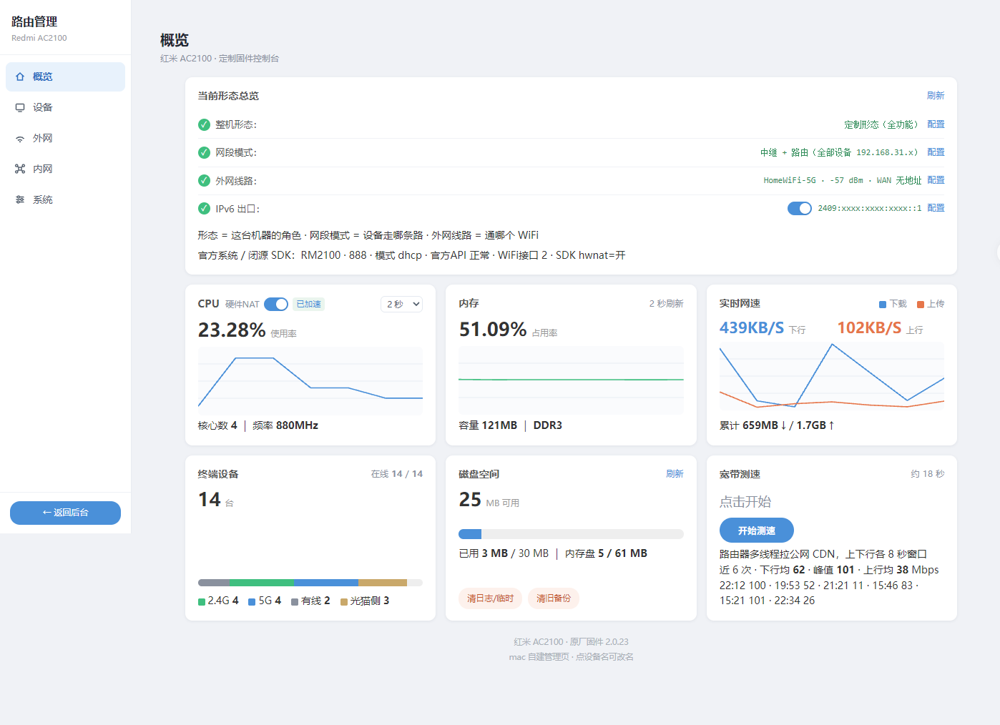
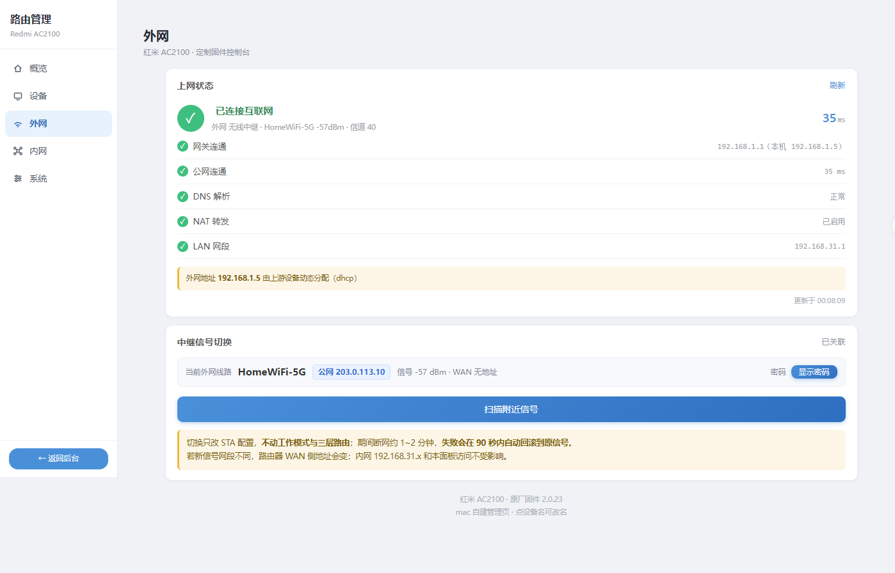
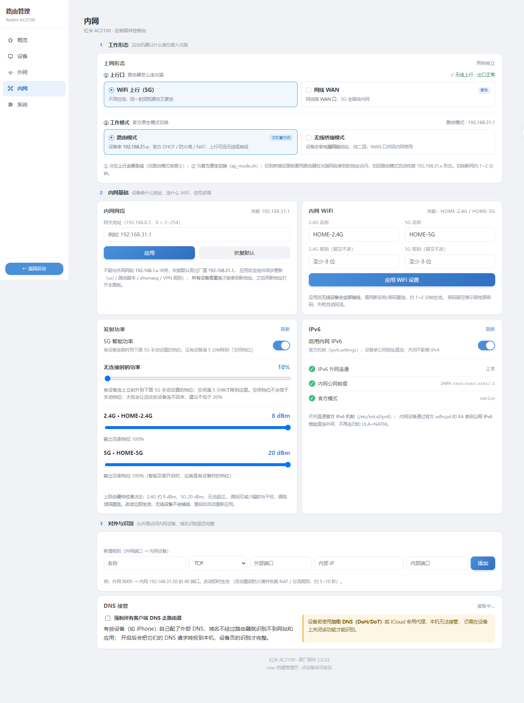
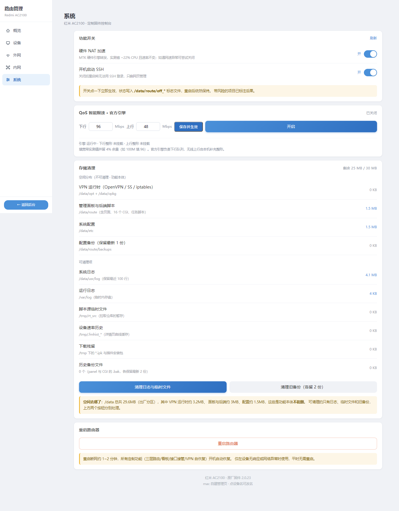
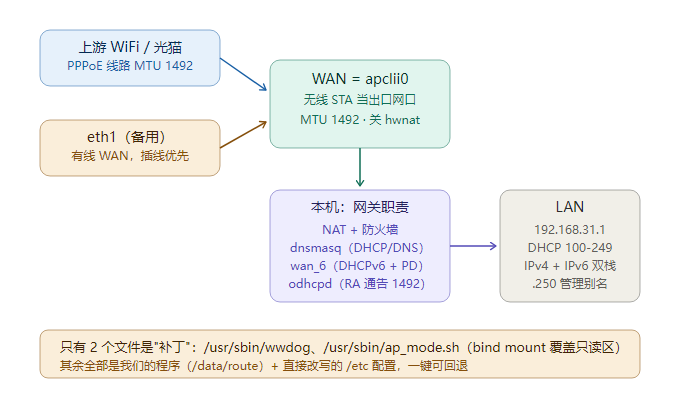
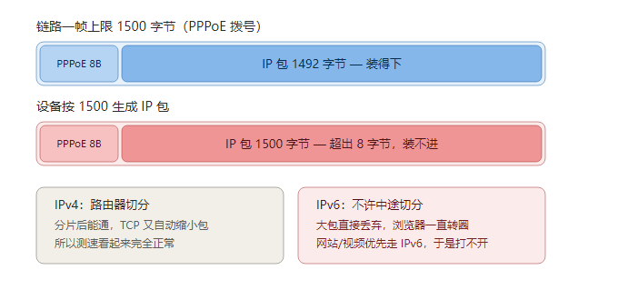

# Redmi RM2100 增强恢复包 · 官方固件 WISP 双栈版

> 面向 **Redmi 路由器 RM2100（小米路由器 4A 千兆版同硬件）** 的官方固件增强包。
> 不刷机、不换固件，在官方系统上把设备变成一台**无线 WAN（WISP）+ 有线 WAN 备份 + IPv4/IPv6 双栈**的稳定家用路由，
> 并配一套自建 Web 面板与自愈机制。**所有改动均可一键回退到官方原样。**

- 恢复包：`router_mode_20261109.tgz`（195 条目，基础形态：WISP 双栈 + 面板 + 自愈）
- 代理增量包：`router_mode_20261117.tgz`（22 条目，ss-libev + DoH DNS 分流；**不含订阅链接、节点密码、WiFi 密码**，见 `docs/代理方案.md`）
- 一键恢复脚本：`恢复-官方路由模式.py`
- 完整性校验：`校验.py`
- 配套文档：`说明.md`（目录级）、`切模式变砖修复报告.md`（踩坑与根因）、`代码审计报告.md`

---

## 界面预览

自建面板（`http://<管理地址>/panel`），纯静态 HTML + CGI，无外部依赖，手机浏览器也能用。

### 概览
形态总览（整机形态 / 网段模式 / 外网线路 / IPv6 出口）、CPU/内存实时曲线、上下行速率、终端统计、一键宽带测速。
CPU 卡片标题行还带两个**快捷胶囊开关**：`硬件NAT`（hwnat）与「IPv6 出口」，不用跳到系统页/内网页就能切换，三处状态双向同步。



### 外网
上网自检六项（网关 / 公网 / DNS / NAT / LAN / 延迟）、当前上游信号，以及**中继信号热切换**入口（只重连 STA，不动 LAN，失败 90 秒自动回滚）。



### 设备
按频段分组的在线设备列表（5G / 2.4G / 有线 / 光猫侧），显示实时速率、累计流量，支持改名、固定 IP、限速。
每台设备点开可看**访问过的域名列表**（由「记录访问域名」开关控制：dnsmasq `logqueries` → `/tmp/dns.log` → 每分钟增量缓冲，读取时合并去重）。


### 内网
上网形态选择、内网网段、内网 WiFi、发射功率、IPv6 开关、端口映射、DNS 接管（把内网发往任意地址的 53 端口重定向到本机 dnsmasq）。



### 系统
SSH 开关、QoS 智能限速、存储占用明细与清理、重启路由器。



> 截图已脱敏：上游 SSID → `HomeWiFi-5G`、内网 WiFi 名 → `HOME-2.4G` / `HOME-5G`、公网 IP → `203.0.113.10`、
> IPv6 前缀 → `2409:xxxx:xxxx:xxxx::1`、MAC → `AA:BB:CC:DD:EE:FF`、设备主机名 → 通用型号名（`Android-Phone-A`、`Windows-笔记本` 等）。

---

## 一、这是什么 / 为什么做

官方固件的「无线中继 / 路由模式」切换开关在这台机器上有个**已知缺陷**：反复切换会卡死在中间态
（小米自己的脚本 TODO 里就写着“路由-中继-路由 顺序执行后会出现错误”），表现为整机 LAN 失联、
只能恢复出厂。

本包做的是**把"切换模式"这件事整个绕开**：直接把设备钉死在
「**路由模式 + 无线 STA 当 WAN**」这一个形态上 —— 这就是 OpenWrt/ImmortalWrt 世界里
标准的 WISP 做法（把 WAN 口从网线换成一个绑到 `wan` 的无线客户端），
既保留官方闭源 MTK 驱动的性能（5G 实测满速），又不需要任何"模式切换"仪式。

---

## 二、功能清单

### 1. 网络形态
| 能力 | 说明 |
|---|---|
| 无线 WAN（WISP） | `apclii0` 作为 WAN 口连上游 WiFi，自己的 LAN 仍是 `192.168.31.1` + 官方 NAT/DHCP |
| 有线 WAN 备份 | 物理 WAN 口 `eth1` 已配成 `wan2`，**插线优先、拔线回无线**，60 秒内自动收敛 |
| 固定管理地址 | `192.168.1.250` 别名，跟着 WAN 接口走（换上游后仍可用同一地址管理） |
| IPv4 / IPv6 双栈 | 上游给就自动拿，`wan_6` DHCPv6 + PD 前缀下发 LAN（`/64`），内网设备自动获得公网 v6 |
| 上游 WiFi 热切换 | 面板换信号：只重连 STA，**不重启、内网设备不掉线**，实测 18 秒完成，失败自动回滚 |

### 2. Web 面板（`http://<管理地址>/panel`）
- 实时状态：上联 SSID/信号/信道、WAN IP、延迟、DNS/NAT/LAN 自检（`/cgi-bin/netstatus`）
- 上游切换：扫描 → 选 SSID → 填密码 → 热切换（失败自动回滚）
- 快捷胶囊：概览 CPU 卡片标题行的 `硬件NAT`、`IPv6 出口`，与系统页/内网页状态双向同步
- 功能开关（系统页）：hwnat 硬件 NAT 加速 —— 走 `hwnat_ctl.sh` 统一入口；该驱动**关闭会连 proc 节点一起拆掉**，直接回写会静默失败造成「面板显示开、实际软件转发」，故重开时自动 `rmmod`+`insmod` 重挂 `hw_nat.ko` 并重新注册无线口
- 设备页：`DNS 接管`（`dnsctl`，标志文件自愈）与 `记录访问域名`（`devicectl?action=dnsq`，日志超 400KB 原地截断保留 200KB）
- QoS：上下行限速（MQC 规则），**自愈机制**：整形丢失后自动补回（带 10 分钟退避，避免死循环重启引擎）
- 无线功率守护、日志查看、设备列表等
- 官方读数桥：把官方 API 数据缓存到 `/tmp/xqapi` 供面板使用（5 分钟节流）

### 3. 稳定性 / 自愈
| 机制 | 作用 |
|---|---|
| `switchguard.sh` 切模式守卫 | 三重判据（进程 + **拓扑指纹** + 冷却），官方切换期间所有周期钩子静默，不再"添乱变砖" |
| `wispguard.sh` + `zz_wisp`(S18) 开机归一 | 开机、netifd 读配置**之前**清除 `NETMODE`，并在拓扑被破坏时按快照恢复 —— 把"以中继形态开机必死"从开机流程里掐掉 |
| `wisp_snap.sh` 配置快照 | `save / status / restore`，一键备份与回滚 WISP 形态（含 firewall），不依赖官方那套一次性快照 |
| **IPv6 防火墙全交官方 fw3** | 只需 `firewall.defaults.disable_ipv6='0'` 一个开关，官方 fw3 就自动生成完整 v6 zone 规则 + wan 区 `TCPMSS clamp to PMTU`。实测：清空全部 v6 规则后仅 `firewall reload` 即自洽（路由器 ping6 32ms、内网 v6 转发 206）。原先自写的 `ipv6_fw.sh` 属冗余，**已完全退役** |
| `dns_hijack.sh` 标志自愈 | DNS 接管规则是纯运行时 iptables 状态，防火墙重载/重启必丢；现以 `/data/route/dns_hijack` 标志为意图，钩子每分钟 `restore` 收敛，`zz_official` 开机恢复。`dnsctl` 分开上报「意图 / 实际规则数」，丢规则时显示「待收敛」而非谎报「未开启」 |
| `hwnat_ctl.sh` 统一入口 | 面板开关 / 开机快照 / 每分钟钩子全部走它。驱动关 0 会拆掉 `/proc/sys/net/hwnat/enable` 节点，直接回写 1 会**静默失败**；本脚本自动 `rmmod`+`insmod` 重挂 `hw_nat.ko`、轮询等节点重建、写 enable=1 并重新注册无线口 |
| `mgmt_alias.sh` | `.250` 别名按形态自动挂到 `apclii0` / `br-lan`，并清理冲突路由 |
| `dualwan.sh` | 双 WAN 优先级收敛；顺带清理官方 `mivpn.sh` 造成的 `default dev br-lan` 幽灵路由 |
| `tmpguard.sh` / `logguard.sh` / `logtrim.sh` | 日志与缓存**全部有上限**：`/tmp` 每 5 分钟检查（>4MB 截到 1MB），`/data` 日志每天裁剪到 200 行；宏命名日志按**进程 pid 存活**清理（不误删活跃句柄），`luci-sessions` 超 200 个时清 1 天前的 |
| **无用日志源头关闭** | `plugincenter`/`datacenter` 用 `GLOG_log_dir` 指向不可写路径 → **完全不落盘**；`syslog-ng` 关闭 `wifi_analysis`（内核 EAPOL）、`stat_points_*`（小米统计）、`meminfo` 五个 destination，**从源头不产生**而非事后清理 |
| `zz_cron` / `zz_dropbear` / `zz_official` | 官方 init 用 procd 而本固件 procd 不认，三个开机兜底脚本负责把 crond / SSH / 补丁挂载真正拉起来 |

### 4. 访问方式
- **Web 面板**：`http://<管理地址>/panel`（无鉴权，仅限内网）
- **SSH**：`root@<管理地址>`，已部署 dropbear + 公钥（`/etc/dropbear/authorized_keys`）
  > 新版 OpenSSH 默认禁 ssh-rsa，连接需加：
  > `ssh -o HostKeyAlgorithms=+ssh-rsa -o PubkeyAcceptedAlgorithms=+ssh-rsa root@192.168.31.1`
- **官方 UI**：`http://192.168.31.1`（原样保留）

### 5. 代理（可选，默认不启用）

| 能力 | 说明 |
|---|---|
| 双内核 | `ss-libev`（约 1.5MB）/ `xray`（约 35MB），面板一键切换；**内核锁定、失败不自动回退** |
| 国内直连 | `chnroute` ipset（7456 段）命中即 `RETURN`，国内流量根本不进代理端口 |
| DNS 分流 | gfwlist → `chinadns-ng` → `smartdns` → **DoH over 443**（实测该机场拦截 53/853，只有 443 能取回真实解析） |
| 节点自愈 | 单节点挂 → 自动切换；全部挂 → 直连刷新订阅再找；恢复后自动重挂规则（10 分钟限频防抖） |
| 面板 | 「代理」页：运行状态 / 内核 / 生效范围（全部或多选设备）/ 订阅与规则 / 节点池 / 系统服务 |

> 细节、文件清单与首次配置见 **[docs/代理方案.md](docs/代理方案.md)**。
> 包内**不含** `config.json`、`sub.url`、`nodes.list` —— 订阅与节点需自行填写。

---

## 三、架构：改了官方什么

官方根文件系统是 **squashfs（只读）**，root 也写不进去。所以：

| 层 | 内容 | 数量 |
|---|---|---|
| **真正的补丁**（bind mount 覆盖只读文件） | `/usr/sbin/wwdog`（在官方看门狗里插入我们的每分钟钩子）、`/usr/sbin/ap_mode.sh`（兜底模板加保护） | **2 个** |
| 直接改写的官方文件（`/etc` 是可写 overlay） | `nginx.conf`、`crontabs/root`、`init.d/zz_*` | 数个 |
| 自有程序 | `/data/route/*.sh` + `/data/route/www/cgi-bin/*` + 面板 | 51 脚本 / 24 CGI |

> 结论：不是"补丁套补丁"，而是**官方固件 + 2 个只读文件被替换 + 一套自己的程序**。
> 想彻底零补丁只有刷 OpenWrt 系（需先刷 breed），代价是丢闭源驱动性能与米家生态。

### 关键链路
```
面板/CGI ──► /data/route/*.sh ──► uci / ip / iptables
   官方 wwdog(每分钟) ──► official_hook.sh ──► switchguard → xqapi_bridge / dualwan / MTU收敛 / hwnat收敛 / DNS缓冲
   开机：zz_wisp(S18) → zz_official(S19 挂载补丁 + 拉起守护 + DNS接管恢复) → zz_dropbear(S20) → zz_cron(S51)
```



---

## 四、恢复包目录结构

```
data/route/
├── *.sh                 业务脚本（dualwan / mgmt_alias / qos_official / upstream / wisp_snap …）
├── hwnat_ctl.sh         硬件 NAT 开关统一入口（节点缺失自动重挂模块）
├── dns_hijack.sh        DNS 接管 on/off/restore（标志文件驱动自愈）
├── dnslog_guard.sh      访问域名日志看护（原地截断保 inode、fd 失效时重启）
├── patches/
│   ├── wwdog.patched    官方看门狗补丁版（bind mount 用）
│   ├── official_hook.sh 每分钟钩子（守卫 → 数据桥 → 双WAN → MTU/hwnat 收敛 → DNS 缓冲）
│   └── xqapi_bridge.sh  官方 API 读数据桥
├── www/
│   ├── panel.html       自建面板
│   └── cgi-bin/         23 个 CGI（netstatus / wlanctl / bridgectl / qosctl …）
├── bin/                 随包的可执行组件（本地代理/工具）
├── tasks/               任务脚本
└── www/                 面板与 CGI
etc/
├── init.d/zz_*          开机钩子（wisp / official / dropbear / cron）
├── crontabs/root        定时任务
├── nginx/               面板路由与 nginx.conf
└── dropbear/            SSH 主机密钥与授权公钥
```

---

## 五、使用说明

### 5.1 全新部署（恢复出厂后）

1. 路由器用官方初始化向导设好管理密码、连上上游 WiFi（向导选"无线中继"或"路由"都行）
2. 电脑连上路由器（有线最稳），确认能打开 `http://192.168.31.1`
3. 运行恢复脚本（Windows / macOS / Linux 均可，需 Python 3）：

```bash
python 恢复-官方路由模式.py --ip 192.168.31.1
# 只看结果不重启：
python 恢复-官方路由模式.py --ip 192.168.31.1 --no-reboot
```

脚本会通过官方 API（自动登录拿 stok）把包递进去、解包、修权限、装开机钩子、
写字段级 uci（`wan=apclii0` / `lan=31.1` / 删 `NETMODE` / IPv6 native）、重启一次。

4. 重启后访问 `http://192.168.31.1/panel` 应看到面板；外网与 IPv6 自动就绪。

> 默认管理密码写在脚本里的 `DEFAULT_PWD`，公开版是占位符 `YOUR_ROUTER_PASSWORD`，**用前请改成你自己的密码**。

### 5.2 日常使用

| 想做的事 | 怎么做 |
|---|---|
| 换上游 WiFi | 面板 → 扫描 → 选 SSID → 密码 → **热切换**（18 秒，内网不掉线，失败自动回滚） |
| 有线当 WAN | 把网线插到路由器**独立 WAN 口**，60 秒内自动切有线；拔掉自动回无线（`cat /tmp/.wan_active` 看出口） |
| 看运行状态 | 浏览器打开 `/cgi-bin/netstatus`（JSON），或面板顶部状态卡 |
| 改内网段/密码 | 用官方 UI 改，重启**不会被覆盖**（只有拓扑被破坏时开机归一生效） |
| 备份当前形态 | `ssh root@<ip> 'sh /data/route/wisp_snap.sh save'` |
| 回滚形态 | `sh /data/route/wisp_snap.sh restore`（会用快照覆盖 network/wireless/dhcp/firewall 并重启） |

### 5.3 校验恢复包

```bash
python 校验.py
# 输出「结论: 校验通过，可用于恢复」即为完整
```

---

## 六、故障处理

### 网页/视频打不开，但测速正常（重要）
典型是 **MTU 与上游不一致** + **无线 STA 重传**，而不是"没网"：



```bash
# 1) 查真实路径 MTU（1465 字节即"需要拆分"则说明真实 MTU 是 1492，PPPoE）
ping -4 -n 1 -l 1464 -f 223.5.5.5     # Windows，1464+28=1492 应通
# 2) 查接口 MTU（必须 1492）
cat /sys/class/net/apclii0/mtu
# 3) 查无线重传（PER 高说明链路质量差）
iwpriv apclii0 stat | grep -E 'Tx fail|AMPDU Tx fail|Rx with CRC'
```

- **MTU**：本包把 WAN/LAN/eth0 固定 1492，`official_hook` 每分钟复检（无线重关联后接口会回弹 1500）。
  IPv6 大包不会中途分片，MTU 不匹配时网页/视频直接卡死，而 TCP 测速因 MSS 钳制看起来正常 —— 就是这个现象。
  - 内网设备侧的 1492 是**自动**的：odhcpd 在 RA 里带 MTU 选项（RFC 4861，主机必须遵守），实测 Windows 的 IPv6 接口 MTU 已自动变 1492
  - IPv4 侧没有等价强制机制（DHCP option 26 只是建议，Windows 直接忽略），只能靠 MSS 钳制 + ICMP `frag needed` 兜底
  - **以太网本身没有 MTU 协商**：插网线到上游 LAN 口同样是 1500；只有路由器自己 PPPoE 拨号时，pppd 才有 LCP 协商出 1492
  - 官方 fw3 的 `mtu_fix` 对 **v4/v6 都生效**（前提 `disable_ipv6=0`），规则形式为 `clamp to PMTU`（按接口 MTU 现算，非写死）；实测 v4 命中 2901 / v6 命中 2014 个 SYN，开销可忽略
- **无线重传**：若 `AMPDU Tx fail` 的 PER 长期 >10%，说明上游链路质量差。
  常见原因是 **80MHz 带宽与邻居信道重叠**（用 `iwpriv apclii0 get_site_survey` 看周边），
  或信号偏弱。缓解办法：换一个更干净的上游 SSID / 频段，或用面板热切换换 AP。
- **hwnat（硬件 NAT）**：默认**开启**，面板可随时切换（概览 CPU 卡片「硬件NAT」胶囊，或系统页功能开关）。
  MT7621 的 PPE 硬件转发在多线程满载时差距显著 —— 实测开 300+Mbps / 关约 100Mbps（约 3 倍）；
  单线程且上游不富裕时两者接近（曾测 18.6 vs 18.1 MB/s）。
  判断方法：开启后 `/proc/sys/net/hwnat/enable` 存在且为 1；关闭时该 proc 节点会**整个消失**（驱动行为）。
  > 上游本身只有 90Mbps 时开与关看不出差异——瓶颈不在路由器，切换 hwnat 也没用。

### 无外网（最常见）
按顺序查：
```bash
ip route | grep '^default'          # 应只有 via 192.168.1.1 dev apclii0
ping -c2 223.5.5.5                  # 路由器自身出网
nslookup baidu.com 192.168.31.1     # 本机 DNS
cat /tmp/.wan_active                # 当前出口（wireless/wired）
```
- **默认路由出现 `dev br-lan`** → 官方 `mivpn.sh` 的老架构遗留，`sh /data/route/dualwan.sh` 会清掉（每分钟自动）
- **DNS 失败** → 上游网关不提供 DNS 时，dnsmasq 上游必须是公共 DNS（包内已固化 `114.114.114.114 / 223.5.5.5`）
- **面板显示"无法上网"但实际能上** → 老版本误判，本包已修（网关 ICMP 失败退回 ARP 邻居判断、DNS 回退公共解析、只有公网真不通才判 fail）

### IPv6 拿不到
本包已处理三层，若仍异常按此排查：
```bash
ubus call network.interface.wan_6 status   # 应有 "up": true，且 ipv6-prefix 非空
ip6tables -S | head -3                     # 三条链策略不能是 DROP 且无规则
ip -6 addr show apclii0 | grep 'inet6 2'   # 应有 2409/2408/240e 开头地址
uci get firewall.@defaults[0].disable_ipv6 # 必须为 0（官方 fw3 据此生成全部 v6 规则与 MSS 钳制）
/etc/init.d/firewall reload               # 规则异常时重载，官方自动重建；无需自写脚本
```
> 注意：**本固件的 `ping6` 是坏的**（连 `::1` 都报 `Operation not permitted`），
> 不要用它判断 IPv6 通不通；用 `curl`/浏览器测，或看 `ip -6 addr` 与 `ip -6 route`。
> 另外 `curl -6` 若带系统代理变量会误报 000，须加 `--noproxy "*"`。

### 卡死 / 失联
1. 断电重启（冷启动后 SSH 100% 可用）
2. 若起来仍是中继态：`uci delete xiaoqiang.common.NETMODE; uci commit xiaoqiang; reboot`
3. 仍不对：`sh /data/route/wisp_snap.sh restore`（有快照时）
4. 最后手段：恢复出厂，再跑 `恢复-官方路由模式.py`

---

## 七、注意事项与已知限制

- **不要再使用官方「切换中继/路由模式」入口**：本包已在 WISP 形态下**禁用官方通道**
  （`wlanctl?action=oswitch` 直接返回 `code:6`），面板切换按钮也改成了热切换。
  官方那套"快照覆盖 + 重启"流程是历史上多次卡死的根源。
- 官方 IPv6 开关**可以正常用**：本包配置与官方 `enable_ipv6 wan native` 完全一致（`wan_6` + `ip6assign`）。
- 恢复包会覆盖 `/etc/crontabs/root`、`/etc/nginx/*`、`/etc/init.d/zz_*`；官方 OTA 升级后需要重新部署一次。
- 面板默认无鉴权（仅内网），需要鉴权可 `touch /data/route/.auth_required`（配合官方 LuCI 会话）。
- `l1profile.dat` 打开失败的 dmesg 报错是**出厂就缺该文件**，驱动回落内置默认，非本包引入。

---

## 八、安全与脱敏

公开仓库里的包是**脱敏版**：本机 WiFi 密码、上游 WiFi 密码、路由器管理密码、SSH 公钥
全部替换为 `<REDACTED>` / 占位符，个人配置备份（`mode_backup/`、`backup_pre_*`）已剔除。

重新生成脱敏包：

```bash
sh tools/sanitize.sh
# 产物：dist/router_mode_<日期>_sanitized.tgz，脚本会自检并打印 md5
```

> 真实包（含凭据）请只留在本地，不要提交到公开仓库。

---

## 九、版本记录（摘要）

| 日期 | 变更 |
|---|---|
| 2026-11-09 | WISP 形态固化；切模式变砖根因定位（钩子与官方切换打架）；守卫三判据成型；修 5 个静默 bug（SSD 启动陷阱 / crond 属主 / pgrep 自匹配 / 别名不迁移 / busy 标记过早清除） |
| 2026-11-09 | 双 WAN（有线优先 + 无线兜底）；`wisp_snap` 快照；修 `uci commit wireless` 漏提交、`mgmt_alias` 死代码 |
| 2026-11-09 | 面板"切上游"致整机失联修复：禁用官方通道、改热切换、`official_switch.sh` 加架构守卫、新增开机归一 `wispguard` |
| 2026-11-10 | IPv6 全链路修复：`ip6tables` 三链全 DROP（根因）+ `wan_6` 配置 + MSS 钳制 + 开机/每分钟兜底；官方开关对齐 |
| 2026-11-10 | 开机归一改为"仅拓扑异常才恢复"，不再覆盖用户改动；日志新增 syslog-ng 宏命名文件清理 |
| 2026-11-10 | hwnat 「假开」Bug：驱动关 0 会拆 proc 节点，面板回写 1 静默失败 → 新增 `hwnat_ctl.sh` 统一入口（自动重挂模块 + 重新注册无线口）；概览 CPU 卡片加「硬件NAT」胶囊 |
| 2026-11-10 | 概览加「IPv6 出口」胶囊（直通官方 `ipv6.settings` + `init.d/ipv6`）；修复设备页 DNS 接管状态永远「读取中」（进入页面漏调 `dnsLoad`） |
| 2026-11-10 | 彻底移除自写 IPv6 防火墙脚本（`ipv6_fw.sh` + `zz_ipv6fw`），v6 规则与 MSS 全交官方 fw3；验证 `wan_6` 断线重连自愈 |
| 2026-11-10 | 「记录访问域名」静默失效修复：关闭采用「删除 uci 字段」与配置丢失无法区分 → 改用 `/data/route/no_dnslog` 标志，字段缺失时钩子自动补回 |
| 2026-11-10 | DNS 接管补自愈机制：`restore` 子命令 + 每分钟收敛 + 开机恢复；`dnsctl` 分开上报「意图 / 实际规则数」，不再谎报未开启 |

---

## 十、免责

改动均在官方固件之上，**不刷机、不改分区**，最坏情况恢复出厂即可复原。
但涉及网络底层（路由/防火墙/开机脚本），请自行评估风险；
建议先在本机保留一份原始固件与本文档，重要环境请勿使用。
